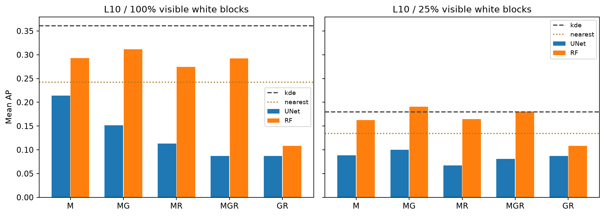
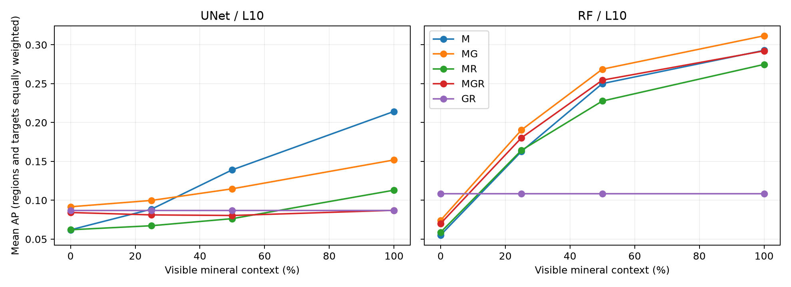

# cap3 正式评价：主比较未通过，保留地质 RF 辅助证据

更新：2026 年 10 月 14 日。版本 `reduced_cap3_v1`。既有冻结模型已在本地 CPU 完成正式预测、独立进程重载、保存预测指标复算及固定配对比较，**没有重新训练**。成功终态为 2026-10-14 02:59:36 UTC（北京时间10:59:36）。工程评价完成，预设科学继续条件未通过，原 B 归档仍有资源计时快照缺口。

## 预设主比较与实际结论

主比较固定为 **L10、白格保留25%的 U-Net MGR−M**，三个上下文重复、三个网络种子、三个地区与金铜两个目标等权，共54项配对。MGR平均AP **0.081193**，M为 **0.088541**，差 **−0.007348**，相对 **−8.30%**；前5%有效面积覆盖率差为 **−1.501个百分点**。完整上下文AP差为−0.127192。

三个地区的AP差为Nevada +0.006521、Arizona +0.015200、Colorado −0.043765；三种子中只有一个方向为正。相对AP增量≥5%、至少两个正向种子及完整上下文差非负未满足；两个正向地区和前5%覆盖下降不超过2个百分点满足。全部预设继续条件没有同时达到。**这些是预先规定的继续投入判据，不是统计显著性检验或发表标准。**

这不支持按当前全模态拼接 U-Net 设置继续追加调参；不能因此推断地质或遥感普遍无用，也不能确定负收益究竟来自样本、尺度还是融合方式。

## 同情景比较与应保留的正结果

范围保持12训练、6验证及Nevada/Arizona/Colorado各3评价块；2 km网格。三区合计22,500个原有效格、90,000 km²，金登记正例格1,526、铜961；不是独立矿床数。相位先合并，再对地区、目标、种子和适用上下文重复等权汇总。

| 输入 | U-Net 完整上下文 AP | U-Net 25% AP | RF 完整上下文 AP | RF 25% AP |
|---|---:|---:|---:|---:|
| M | 0.214292 | 0.088541 | 0.292831 | 0.162854 |
| MG | 0.151896 | 0.099812 | 0.311594 | 0.190499 |
| MR | 0.113005 | 0.067269 | 0.274769 | 0.164353 |
| MGR | 0.087100 | 0.081193 | 0.292197 | 0.180409 |
| GR | 0.087076 | 0.087076 | 0.108517 | 0.108517 |

同一L10情景下，核密度完整上下文AP为0.361258、25%为0.180034；最近同类矿点分别为0.242043和0.134323。完整上下文中核密度高于所有本轮NN/RF组合；25%条件下RF MG保留较好结果，不把不同上下文分数混比。

辅助的单种子RF MG从M的0.162854升至0.190499，相对增加16.97%；它是地质信息可能有用的辅助证据，**不替换未通过的U-Net MGR−M主比较**。U-Net MG在25%上下文也高于M，但全模态MGR并未超过M。各种子、地区、目标、L20及50%/0%诊断保留在[公开聚合表](../results/cap3-formal-v1/README.md)。

图中点是固定情景均值，连线仅帮助比较，不能视为连续上下文比例都已实验；随机种子、复用视图和邻近网格不是新的独立地质样本。

## 完成了哪些检查，仍有哪些限制

已有终态记载704个逻辑相位视图、526份物理预测、55项独立进程重载/案例检查。主表2112行、相位表4224行、分层表21120行，共27456行由另一实现从保存预测复算；配对及判据58778项数值核对通过。重载55项由先前45项NN与修复后10项RF组成，不把失败尝试算为额外有效检查。GR与零上下文按预设规则复用，不增加训练数。

CPU统一单图块、FP32推理。首次批量/单块检查不通过，以及RF对象摘要受未初始化填充字节影响的中断均保留；恢复没有改变原模型权重、样本或指标，RF文件SHA和预测逐值相同要求、NN误差阈值保持。原冻结代码及科学配置未覆盖，CPU执行副本与修复另行留档。

**没有云端逐格输出，未验证CPU与CUDA逐格一致。** 原云资源计时快照 `compute_B_snapshot.json` 未回传，现有2426个冻结关联文件已核对无差异；模型/输入完整不等于原B全归档通过。该缺口须保留，不以CPU评价补写或替代。原GPU训练日志回并记录与本地CPU耗时分别记账，历史未知关机时间不填零。

当前三区在此前多轮探索中已经暴露，不是新盲测地质确认。目标仍是人工隐藏的登记记录排序；未登记不等于无矿，AP或颜色不是校准成矿/整孔见矿概率，遥感可能响应已有采矿活动。K仍未准入。10月12日[验证选择表](cap3-training-stage.md)属于开发阶段，与本页正式评价分开，不横比为性能改进。

## 下一步待讨论事项

1. 保留失败主比较、地质RF辅助结果及KDE强基线，讨论当前融合设置的适用边界，避免按结果换区或删种子。
2. 补齐原资源快照或明确归档限制，再结合具体矿区、岩性和孔级资料界定后续问题。
3. [分组融合准备](group-fusion-preparation.md)先验证同类光谱组的组合机制，CUDA工程试跑与正式效果仍待完成；美国资料独立标签/配准不足时不宣称完整勘查验证。

本次汇报维护只核对终态和来源哈希、重新计算公开聚合均值/差值/判据并检查呈现，**没有重跑模型、逐格AP或科学评价**。原报告和独立复算是已有研究证据，完整日志、预测、权重和复核包保持本地。来源与附件SHA256见[清单](../results/cap3-formal-v1/provenance.json)，AI说明见[复核说明](reproducibility.md)。[阶段进展](progress.md) · [返回首页](../README.md)
