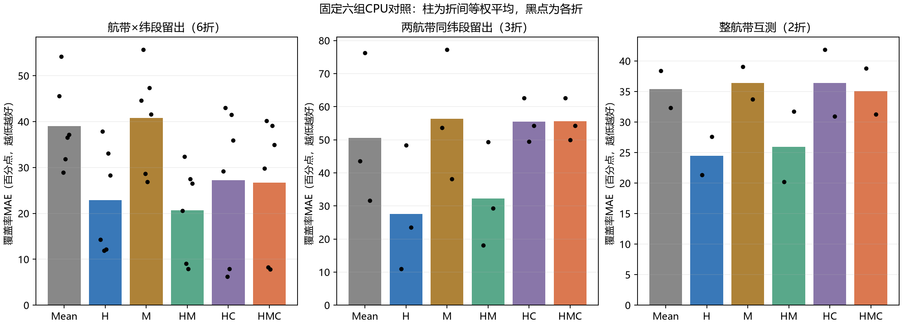
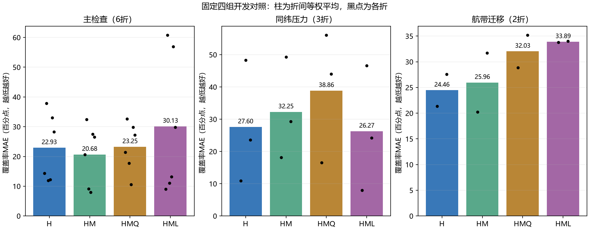

# Cuprite历史蚀变覆盖率：局部航磁增量未扩展为稳定空间收益

更新：2026年10月18日。两轮固定CPU对照已经完成并留档，目标是**400 m完整格内，历史图已绘硅化s/蛋白石化op/泥化a并集的面积占比**。不是纯矿物类别、实际成矿概率、无矿判定或钻孔成功率。历史图白色仅表示未绘这三类，不能解释为现场确证无蚀变。

## 从准备失败到可执行版本

早期三类已知区分母下的95%共同支持准入失败；后续另立完整格覆盖率方案。首个版本虽完成78格输入和11折准备，但24个原图核对点中3处白孔无可靠依据、2处真实接触难辨，停止在拟合0，原失败保留。

续行版本在看模型成绩前逐项查243个孔，依原扫描像元与真实接触描边的来源规则修复211项内部残孔、保留32项；所有外环和保留孔坐标不变。覆盖率最大变化0.102个百分点。24点中19可读、3个伪边界、2个模糊真实接触分别保留，不称24/24地面真值或专家验收。工程标签准入通过后，才执行下面固定矩阵。

## 六组同支持比较

两条航带各39个400 m格，共78格、12.48 km²；372维HSI全格面积均值为H，一维航磁均值为M，坐标C只作诊断。训练折内标准化与PCA≤5，岭alpha固定10，输出按原规则截断到[0,1]。6个航带×纬段、3个同纬压力和2个整航带互测共11折，监督格足迹间至少800 m；三种检查各自等权，不能混成一个总分。

表中为名义标签的MAE，**单位百分点、越低越好**。

| 模型 | 主分段6折 | 同纬压力3折 | 整航带2折 |
|---|---:|---:|---:|
| Mean | 39.047 | 50.533 | 35.383 |
| H | 22.934 | 27.595 | 24.461 |
| M | 40.809 | 56.341 | 36.406 |
| HM | 20.679 | 32.249 | 25.963 |
| HC | 27.277 | 55.454 | 36.403 |
| HMC | 26.679 | 55.632 | 35.036 |

主检查H→HM改善2.255个百分点，相对误差下降约9.83%，6折中5折改善；但同纬压力恶化4.653个百分点，3折均变差，整航带平均恶化1.501个百分点。坐标控制后主改善0.598个百分点，但HC/HMC本身弱于H；不能把坐标增量当作普遍最优或地理混杂的因果分解。

名义加14种预设标签变换共15版，完成825次岭拟合、990条折评价、924条固定名义预测重评，保存21060行预测在本地。全部14种替代标签重拟合时，主检查两项航磁增量同时为正14/14，同纬0/14、整航带3/14。主局部方向对这些扰动稳定，空间外推不稳定；扰动是工程情景，不是置信区间或显著性检验，继续条件未通过。

## 四组表示诊断：不以一个有利检查替代结论

保持同一标签、78格、11折和岭设置，对比H、HM、HMQ（标准化磁均值及平方项）、HML（局部背景对比与非平面残差RMS，替换原M）。它不是固定H后只学习修正，也不学习动态权重。

23处横断采样得到207个相邻测线间隔，中位610.19 m、采样最大1264.77 m，按预写规则取2800 m局部方窗；与早期单中心断面的约577/1154 m是不同口径。窗口内每格3—5条测线，42窗完整、36窗部分覆盖。首次中点纳入法73/78通过，5个边缘格失败；拟合前改为相交面积和质心求积，原窗口、20/10 m步长及0.25 nT门槛不变，最终78/78通过。原失败没有删格或放宽。

| 模型 | 主分段6折 | 同纬压力3折 | 整航带2折 |
|---|---:|---:|---:|
| H | 22.934 | 27.595 | 24.461 |
| HM | 20.679 | 32.249 | 25.963 |
| HMQ | 23.251 | 38.860 | 32.027 |
| HML | 30.135 | 26.266 | 33.894 |

HML同纬MAE从27.595降至26.266，改善1.329个百分点；主检查从22.934升至30.135，迁移从24.461升至33.894。HMQ三个均值也均差于H。14个替代标签重拟合时，HML优于H为主0/14、同纬13/14、迁移0/14；HMQ为5/14、0/14、0/14。两种表示均未通过全部预设继续条件，不能只报同纬收益或断言所有非线性/物探无效。

四组完成660次岭拟合、660条折评价、616条固定预测重评，14040行预测保留本地。局部窗口有重叠：主/同纬的所有测试窗均与某训练窗相交；两个迁移方向各13/39测试窗相交。协议允许已知无标签全场物探，**800 m监督足迹隔离不等于局部输入支持独立**，20 m求积网格也不是20 m实测物探分辨率。

## 实际复核与结论范围

已有独立检查从换目录参数重放两轮保存预测，核对990＋924、660＋616组指标及825/660次岭最优性；四组还复现旧H/HM的7020行。它们是数值与保存模型一致性证据，不是新的野外或独立地质验证。本次汇报维护核对来源/SHA、公开3190行逐折聚合的矩阵、均值/差值/判据和图件；原逐格文件仅作只读清点或哈希检查，没有加载模型、从逐格预测重算指标或再次拟合。

78个相邻格、同一历史地图、共享训练集的11折不等于11个独立区域。1970年代解释与1993航磁、2020光谱年代不同；影像相对定位和标签语义检查不消除全部误差。坐标控制只检查简单趋势，不能证明地质因果；新区域验证和完整地下资料仍缺。

1. 结束这两轮固定矩阵，保留H稳健参照、HM局部增量及所有负结果，不追加窗口或复杂网络搜索。
2. 先明确需要地表岩性、蚀变还是地下结构证据；当前物探与地表历史目标不完全同义，解释只作为假设。
3. 后续[吸收输入与岩性准备](cuprite-lithology-stage.md)尚未取得完整标签，不把旧蚀变成绩填为新岩性结果；新的独立区域/标签优先于模型复杂度。

历史来源：[Ashley与Abrams（1980）原报告](https://pubs.usgs.gov/of/1980/0367/)；公开聚合、全部折和附件SHA见[材料目录](../results/progress-20261018/README.md)。[方法](methods.md) · [复核与AI说明](reproducibility.md) · [首页](../README.md)
