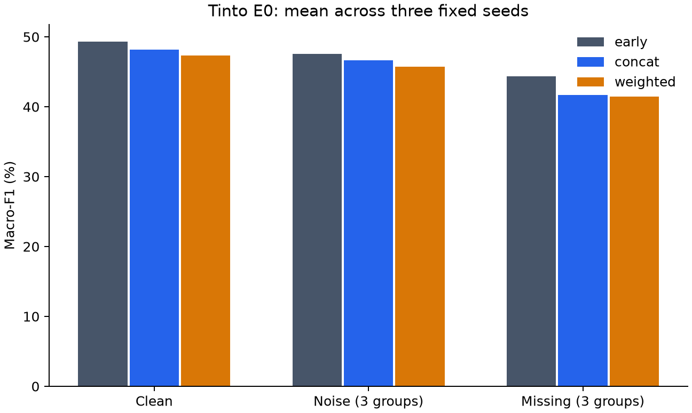

# 分组光谱融合：工程与复核完成，当前方案未显示总体收益

更新：2026年10月15日。任务是同一西班牙矿坑的VNIR/SWIR/LWIR三组光谱十类岩性分类。首轮21次拟合与后续12次补充拟合均已完成，预测和独立复算已有终态；**不等于跨矿区地质验证、完整多模态找矿或钻孔成功概率**。

## 要检验的问题与共同范围

首轮把各组专家的分类分数组合，比较等权B、全局权重C、质量条件动态权重D，保留原始拼接A、三个专家和质量直接校正Q。动态与Q的比较控制可用质量信息。十类标签综合矿物分析、光谱解释和露头制图，**不是逐点独立现场真值**；标签与光谱解释的依赖限制地质外推。

输入、标准化与空间角色沿用[准备记录](group-fusion-preparation.md)：expert62,385、fusion20,887、selection20,807；E0测试2,569,474点。E10/E20为距开发支持更远的辅助子集，分别2,221,982与1,765,653点，不替换E0。三个角色按25 m XY块及每边5 m剔除带隔离，XYZ不进模型；同矿坑密集邻点与三个种子仍不是独立地质样本。

## 首轮固定比较：小幅动态增量不足以支持继续

三个种子17/29/43、八种模型、干净/三噪声/三整组缺失，共168份预测、504条子集评价。噪声为标准化后单组高斯扰动，标准差0.5；人工扰动不代表自然缺失总体。

| 模型 | 干净macro-F1（%） | 三噪声均值（%） | 三整组缺失均值（%） |
|---|---:|---:|---:|
| VNIR专家 | 32.661 | 31.010 | 23.325 |
| SWIR专家 | 44.080 | 41.994 | 29.762 |
| LWIR专家 | 27.224 | 26.034 | 18.754 |
| A 原始拼接（宽70） | 49.779 | 48.123 | 44.626 |
| B 等权 | 44.537 | 42.589 | 39.717 |
| C 全局权重 | 45.893 | 43.900 | 40.701 |
| D 动态权重 | 46.160 | 44.167 | 41.023 |
| Q 质量直接校正 | 45.918 | 44.033 | 40.818 |

预设主比较为E0三噪声的D−C，先对三个条件等权，再对三个种子等权；差为 **+0.267个百分点**，种子17/29/43分别−0.185、+0.610、+0.378个百分点，2/3正向。D−Q为+0.134个百分点，D比A低3.956个百分点。+2个百分点门槛未达到，首轮继续判据未通过；E10/E20的D−C约+0.214/+0.070个百分点仅作辅助。这不是统计显著性结论，也不证明所有分组融合都无效。

## 补充对照一：额外优化能解释大部分旧增量

看过首轮测试结果后，另行固定补充方案，从同一种子的C最佳检查点出发，仅继续训练全局参数，冻结专家并重置AdamW。按旧D完成的额外训练曝光固定29/20/21轮；在V域选择本预算内最佳检查点。该固定预算与旧D提前停止算法仍有差别。

新增3次继续训练、21份预测。E0三噪声下，C由43.900%变为44.144%，提高0.244个百分点；旧D为44.167%，D−C_continue仅 **+0.024个百分点**（2/3种子正向）。干净场景C_continue为46.162%、旧D46.160%，几乎相同。原先0.267个百分点不能稳妥归因于质量门控；该诊断没有新增工程门槛，记录中的null不写成通过或失败。

## 补充对照二：分类前分组特征仍未超过匹配拼接

三种模型均从随机初始化开始，只用expert训练、selection选择；两个分组模型共同编码器和分类头显式配对初始化，权重模型额外使用相同质量信息，避免把输入差异当收益。本轮early宽74以匹配参数量，与首轮宽70的A分别报告，不把两轮分数相减包装成提升。三种子共9次拟合、63份预测。

| 本轮模型 | 参数数 | 干净macro-F1（%） | 三噪声均值（%） | 三整组缺失均值（%） |
|---|---:|---:|---:|---:|
| 原始拼接（宽74） | 50756 | 49.331 | 47.581 | 44.319 |
| 分组特征拼接 | 50954 | 48.173 | 46.636 | 41.720 |
| 分组特征加权后拼接 | 50984 | 47.361 | 45.696 | 41.477 |

噪声主比较“加权−不加权”为 **−0.940个百分点**，三个种子分别−0.456、−0.699、−1.665，0/3正向；“分组拼接−匹配原始拼接”为 **−0.945个百分点**，三个种子也均为负。加权模型比匹配early低1.885个百分点。门控增量与不弱于early的继续条件均未通过；E10/E20不改变总体结论。当前结果不能把首轮失败只解释为最后分类分数的压缩问题。

少数类有改善也有退步：噪声下，不加权分组特征的硫化物F1从51.611%至56.374%、页岩从58.498%至63.807%，felsicC从51.829%至41.577%。完整十类及条件保留在[聚合附件](../results/group-fusion-20261015/README.md)，不以有利类别替换主指标。

## 权重行为与实际复核的边界

预定8192诊断点上，受噪声组的平均权重约下降3.049/2.716/1.008个百分点，整组缺失权重严格为零，但未转化为总体macro-F1收益。该样本不是全量测试分布；点间总体标准差不是置信区间。编码器尺度与分类头可以补偿，权重不等于地质贡献。

原v1因CUDA确定性保护触发中位数计算阻断；独立v1.1改为稳定排序下中位数，原冻结源保留。真实20步GPU工程试跑通过后完成首轮训练。首次评价因64线程开销中止，保留8组已完成输出；先在开发域核对单线程输出，再在新目录完成固定矩阵，重叠8组预测/诊断数组逐值一致，未改科学配置。

已有研究审计核对首轮121项训练产物、45份检查点、3501项断言；正式168预测的504条子集指标云端及本地复算通过。补充轮84份新预测的252条指标也已双端复算，权重/轨迹审计1940项断言、30检查点、165次张量精确比较通过，354项增量产物取回核验。工程检查和文件验收不代表方法有效。

本次汇报维护另行核对来源绑定及三套备份1019文件的大小/SHA256，从**已保存混淆矩阵**重算756条聚合指标、全部条件/种子均值与配对判据；没有重载模型、重做逐点复算、训练或CUDA运算。完整记录和实际验证明确区分，附件来源见[SHA256清单](../results/group-fusion-20261015/provenance.json)。

## 结论与下一步待讨论

首轮与补充轮均不支持当前分组质量加权设置优于简单拼接；继续训练对照使质量门控增量的解释更谨慎。补充轮使用已看过的同矿坑测试集，**不是新的独立确认**；未建立跨矿区能力、原创性或地质因果结论。美国同区资料的配准和独立标签、完整孔级资料问题仍未解决，不能由Tinto成绩替代。

1. 保留原始拼接及全部负结果，停止本版追加模型与调参，不根据测试结果筛选种子或类别。
2. 先明确需要新增哪类真实观测和独立标注，核查标签依赖与空间相关性，再讨论新假设与评价资料。
3. 美国资料先补配准、来源与独立监督；有新的独立支持后另定协议，不把岩性分类写成找矿或整孔见矿概率。

[阶段进展](progress.md) · [方法](methods.md) · [复核与AI说明](reproducibility.md) · [返回首页](../README.md)
