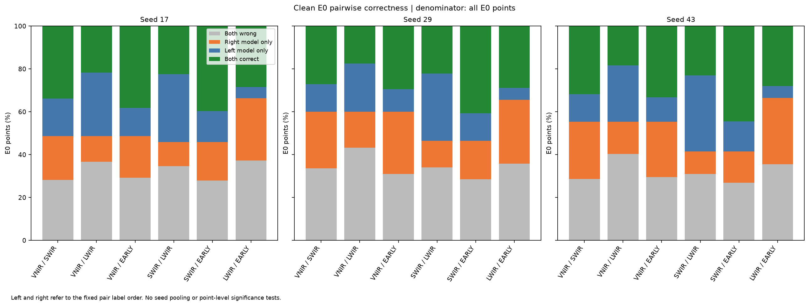

# Tinto已有预测诊断：互补判断存在，尚未验证可用选择规则

更新：2026年10月18日。读取首轮宽70拼接和三个单组专家模型已有84份预测、252条指标，完成63组互补计数及252条正确性变化，另有691个25 m描述性空间块；新增训练0、模型前向0。此分析没有重启已结束的质量/特征加权实验，10月15日全部负结果保持。

## 干净条件下的联合正确性

以下是E0的2,569,474个测试点上，三个种子分别计算后等权的点比例，**不是macro-F1**。

| 观察 | 三种子均值 |
|---|---:|
| 至少一个现有专家正确 | 77.021% |
| 有专家正确而拼接错误 | 23.443% |
| 三专家与拼接共同错误 | 18.129% |
| 仅拼接正确 | 4.850% |

77.021%是知道真值后理想选择已有专家的覆盖率，不是可部署模型成绩，也不是macro-F1上限。23.443%提示尚未解释的互补判断，未证明仅凭可用输入能够学到正确选择；拼接还在4.850%的点上超过所有专家，不能直接用专家选择替代联合输入。

## 保留类别差异与输入干预边界

LWIR整体较弱，却是硫化物类最好的单组专家；SWIR在shale、maficA、maficB上高于拼接。缺LWIR时旧拼接macro-F1增加约2.000个百分点，同时10.070%的点由正确变错误；缺SWIR则macro-F1下降13.874个百分点。这是既有模型的人工输入干预，不是重新训练的去模态消融，不能据此删除某传感器或宣称其地质贡献为负。

全部七条件、三种子、E0/E10/E20和逐类整数计数保留。缺失时联合覆盖排除已缺失专家的偏置输出；两两表中相应偏置比较有明确标志。691个空间块、密集邻点和初始化种子不是独立矿区样本；E10/E20嵌套且类别构成变化，不能把降幅完全归因为距离。

已有独立审核11245项检查通过，其中独立逐点交叉计数仅为seed17干净E0的四份预测，其余核对来源、指标与计数恒等式；未重新验证旧168预测全矩阵。本次维护只从公开聚合计数复算比例、支持与原公开模型准确率的一致性，不读取逐点数据或重做科学验证。

价值是区分“专家有正确判断但拼接遗漏”和“现有模型共同失败”，不能据计数确定标签歧义、观测不足、空间变化或模型能力的各自原因。[Cuprite同区对照](cuprite-cpu-results.md)另有历史目标，不能把Tinto标签搬作美国真值。后续仍优先新增独立资料与清楚的问题，不承诺可训练收益或矿床发现。

[公开计数与来源SHA](../results/progress-20261018/README.md) · [原两轮比较](group-fusion-results.md) · [复核与AI说明](reproducibility.md) · [首页](../README.md)
